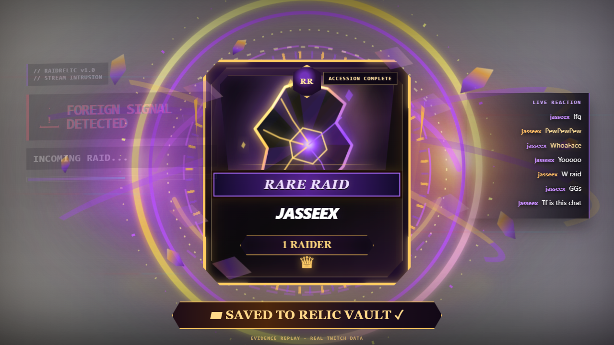

# RaidRelic

**Every raid leaves something behind.**

RaidRelic turns a Twitch raid and the first burst of chat that follows it into a one-of-one collectible relic on stream. A real `channel.raid` event hijacks the OBS browser overlay, chat messages and emotes visibly charge the forge, rarity is derived from participation stats, and the completed relic is persisted to a Raid Archive.



## Why RaidRelic

A normal raid alert is useful for a few seconds, then it disappears. RaidRelic makes the handoff itself the content: the incoming community helps shape a visual artifact that survives after the alert is gone.

- **Real Twitch integration:** EventSub `channel.raid` + `channel.chat.message`.
- **OBS-native:** transparent browser-source overlay; no viewer setup required.
- **Chat-driven forging:** messages, unique chatters and emotes increase charge and change the artifact.
- **Stat-driven rarity:** Common → Rare → Epic → Legendary from raid/chat participation, not a hard-coded label.
- **Persistent memory:** completed relics are archived in SQLite and survive app restarts.
- **Deterministic artifacts:** the same session data produces the same relic.

## Live proof

RaidRelic has been exercised against real Twitch channels (`jasseex` → `shalyx_04`) with simulation disabled.

Observed acceptance evidence includes:

- real incoming raid delivery;
- real chat mutation during the 45-second forge;
- real emote fragment detection and mutation;
- Twitch event → visible OBS overlay in under one second on two measured raids;
- transparent OBS rendering;
- timer completion and archive persistence;
- exact archived-relic recovery after a process restart.

See [`evidence/live-twitch-run-2026-11-01.md`](evidence/live-twitch-run-2026-11-01.md) and [`evidence/final-demo-proof.json`](evidence/final-demo-proof.json).

The four `final-demo-*.png` images are deterministic UI re-renders of one persisted **real Twitch** session so the visual stages can be inspected without performing another raid. They are explicitly labeled `EVIDENCE REPLAY · REAL TWITCH DATA`; they are not presented as simultaneous live screenshots.

## Architecture

```text
Twitch raid + chat
       │
       ▼
EventSub WebSocket
(channel.raid + channel.chat.message)
       │
       ▼
RaidRelic engine ── SQLite archive
       │
       ├── deterministic relic state / rarity / charge
       │
       ▼
SSE snapshot stream
       │
       ▼
Browser overlay → OBS → Twitch stream
```

- `app/twitch.py` — EventSub WebSocket, token validation, subscriptions, reconnect/migration handling.
- `app/engine.py` — deduplication, 45-second forge, chat/emote stats, deterministic relic state, SQLite archive.
- `app/server.py` — OAuth, SSE/API routes, dashboard, explicit developer simulation.
- `app/index.html` — dashboard + transparent OBS overlay + real-chat reaction rail.

## Run locally

Requires Python 3.11+.

```bash
python -m venv .venv
# Windows: .venv\Scripts\activate
# macOS/Linux: source .venv/bin/activate
pip install -r requirements.txt
python -m app.server
```

Open `http://localhost:3000`.

### Connect Twitch

Create a Twitch developer application with this exact OAuth redirect URL:

```text
http://localhost:3000/auth/callback
```

Set `TWITCH_CLIENT_ID` and `TWITCH_CLIENT_SECRET` in the process environment, then start the app and authorize the receiving broadcaster. The UI is ready when it reports `connected · 2/2 EventSub`.

On Windows, `Start-RaidRelic-Secure.ps1` provides a local launcher that prompts for the Client ID and hidden Client Secret and keeps them only in the process environment.

### Add the OBS overlay

After authorization, copy the displayed `/overlay/<broadcaster-id>` URL into an OBS Browser Source. Recommended canvas/source size: **1920×1080**. The page background is transparent so the live stream remains visible behind the RaidRelic takeover.

## Development simulation

Simulation is disabled by default and is kept in a separate source namespace so it cannot masquerade as Twitch evidence.

```bash
RAIDRELIC_SIMULATION=1 python -m app.server
```

Use `/overlay/simulation` only for local visual iteration. Real acceptance evidence uses the Twitch source path.

## Tests

```bash
python -m unittest discover -s tests -v
```

Current result: **6/6 passing**. Tests cover event deduplication, source isolation, concurrent/late chat guards, archive/restart behavior, EventSub reconnect contract behavior, and HTTP/SSE/simulation guards.

## Security / data handling

- Twitch secrets and user access tokens are not committed or written to the relic archive.
- OAuth grants are held in memory for the running process.
- `.env*`, SQLite runtime files, logs and local caches are excluded from Git.
- The reaction rail stores only a bounded recent-chat window for the forge/archive display.

## Hackathon

Built for the **Codex x TwitchCon Hackathon** using OpenAI Codex and Twitch EventSub/chat. The official submission requires a runnable code repository, a public YouTube demo under three minutes showing Twitch and Codex, a project description, and the Codex session ID used for most of the build.

Codex build session: `01a18920-5b89-704d-a5d8-fe8f5e392069`.

## Known limits

RaidRelic is a hackathon prototype: one broadcaster per process, local/loopback hosting, no production multi-tenant auth, no automatic OAuth refresh, and no replay of Twitch events missed while EventSub is disconnected. The product intentionally focuses on the live raid → community forge → relic archive loop.
